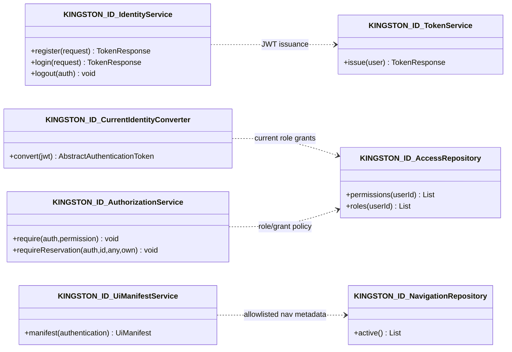

# SmartStay coursework class diagram and OOP rationale

**Status:** Draft diagram based on implemented Java classes (through PR #8). Not submission-ready until the student's actual Kingston ID has been supplied, all diagram class names are updated, and a readable UML image is exported.

> **Mandatory identity check:** The CI6115 draft coursework says **every class name in the submitted diagram must be prefixed with your Kingston University student ID**. The literal token `KINGSTON_ID_` below is a deliberate placeholder, **not** a valid student ID. Do not submit the diagram with that token. This diagram uses UML display names with the prefix; the Java package/class names remain their original source names.

## Main persistent object and service class diagram

```mermaid
classDiagram
direction TB

class KINGSTON_ID_GuestEntity {
  -UUID id
  -String documentNumber
  -String fullName
  -String contactNumber
  -String email
  +getId() UUID
  +getFullName() String
}
class KINGSTON_ID_UserEntity {
  -UUID id
  -String email
  -String passwordHash
  -String displayName
  -UUID guestId
  -boolean active
  -long tokenVersion
  +invalidateTokens() void
  +disable() void
}
class KINGSTON_ID_RoomEntity {
  -String id
  -RoomType roomType
  -BedType bedType
  -int capacity
  -RoomOperationalStatus operationalStatus
  -boolean active
  +update(type, bed, capacity, status) void
  +retire() void
}
class KINGSTON_ID_RoomPackage {
  <<record>>
  +RoomType roomType
  +BigDecimal dailyRate
  +boolean breakfastIncluded
  +BigDecimal extraGuestRate
  +BigDecimal taxRate
}
class KINGSTON_ID_StayPeriod {
  <<record>>
  +LocalDate checkIn
  +LocalDate checkOut
  +nights() long
  +overlaps(other) boolean
}
class KINGSTON_ID_ReservationEntity {
  -UUID id
  -LocalDate checkIn
  -LocalDate checkOut
  -int guestCount
  -ReservationStatus status
  -BigDecimal advancePaid
  +cancel(when) void
  +reschedule(stay, count) void
  +getStay() StayPeriod
}
class KINGSTON_ID_InvoiceEntity {
  -UUID id
  -BigDecimal baseCharge
  -BigDecimal extraCharge
  -BigDecimal discountAmount
  -BigDecimal taxAmount
  -BigDecimal grossTotal
  -BigDecimal advanceApplied
  -BigDecimal balanceDue
  -boolean voided
  +reprice(package, charges) void
  +voidInvoice() void
}
class KINGSTON_ID_InvoiceBreakdown {
  <<record>>
  +BigDecimal baseCharge
  +BigDecimal extraGuestCharge
  +BigDecimal longStayDiscount
  +BigDecimal taxAmount
  +BigDecimal grossTotal
  +BigDecimal balanceDue
}
class KINGSTON_ID_BookingRequestEntity {
  -UUID id
  -UUID requestedBy
  -LocalDate checkIn
  -LocalDate checkOut
  -int guestCount
  -BookingRequestStatus status
  +approve(staffId, bookingId, now) void
  +reject(staffId, note, now) void
  +withdraw() void
}
class KINGSTON_ID_ReservationAmendmentEntity {
  -UUID id
  -UUID changedBy
  -LocalDate previousCheckIn
  -LocalDate newCheckIn
  -int previousGuestCount
  -int newGuestCount
  -BigDecimal previousGrossTotal
  -BigDecimal newGrossTotal
}
class KINGSTON_ID_PricingCalculator {
  <<utility>>
  +calculate(package, stay, capacity, guests, advance) InvoiceBreakdown
}
class KINGSTON_ID_BookingRules {
  <<utility>>
  +requireBookingNotice(now, checkIn) void
  +requireCancellationAllowed(status, now, checkIn) void
  +requireModificationAllowed(status, now, originalCheckIn) void
}
class KINGSTON_ID_BookingManagementService {
  +create(request) BookingReceipt
  +cancel(bookingId) ReservationView
  +find(bookingId) ReservationView
  +invoice(bookingId) InvoiceView
  +search(id, name, checkIn) List
}
class KINGSTON_ID_BookingRequestService {
  +submit(auth, input) BookingRequestView
  +approve(auth, id, advanceReceived) BookingRequestView
  +reject(auth, id, reason) BookingRequestView
  +withdraw(auth, id) BookingRequestView
}
class KINGSTON_ID_ReservationModificationService {
  +change(id, request, actorId) BookingReceipt
  +history(id) List
}
class KINGSTON_ID_AuthorizationService {
  +require(auth, permission) void
  +requireGuest(auth, guestId, any, own) void
  +requireReservation(auth, bookingId, any, own) void
}
class KINGSTON_ID_AccessRepository {
  +permissions(userId) List
  +roles(userId) List
  +assignRole(userId, role) void
}
class KINGSTON_ID_RoomManagementService {
  +create(request) RoomView
  +update(id, request) RoomView
  +retire(id) void
}
class KINGSTON_ID_RoomAvailabilityService {
  +search(checkIn, checkOut, type) List
}

KINGSTON_ID_UserEntity "0..1" --> "0..1" KINGSTON_ID_GuestEntity : optional linked profile
KINGSTON_ID_ReservationEntity "0..*" --> "1" KINGSTON_ID_GuestEntity : guest
KINGSTON_ID_ReservationEntity "0..*" --> "1" KINGSTON_ID_RoomEntity : allocated room
KINGSTON_ID_ReservationEntity ..> KINGSTON_ID_StayPeriod : validates interval
KINGSTON_ID_InvoiceEntity "1" --> "1" KINGSTON_ID_ReservationEntity : invoice for
KINGSTON_ID_InvoiceEntity ..> KINGSTON_ID_InvoiceBreakdown : monetary snapshot
KINGSTON_ID_RoomEntity ..> KINGSTON_ID_RoomPackage : category pricing
KINGSTON_ID_BookingRequestEntity "0..*" --> "1" KINGSTON_ID_GuestEntity : requested guest
KINGSTON_ID_BookingRequestEntity "0..*" --> "1" KINGSTON_ID_RoomEntity : requested room
KINGSTON_ID_ReservationAmendmentEntity "0..*" --> "1" KINGSTON_ID_ReservationEntity : revision
KINGSTON_ID_BookingManagementService ..> KINGSTON_ID_BookingRules : validates deadlines
KINGSTON_ID_BookingManagementService ..> KINGSTON_ID_PricingCalculator : calculates
KINGSTON_ID_BookingRequestService ..> KINGSTON_ID_BookingManagementService : confirms after review
KINGSTON_ID_ReservationModificationService ..> KINGSTON_ID_PricingCalculator : recalculates
KINGSTON_ID_ReservationModificationService ..> KINGSTON_ID_BookingRules : validates cutoff
KINGSTON_ID_RoomAvailabilityService ..> KINGSTON_ID_RoomEntity : checks inventory
KINGSTON_ID_RoomManagementService ..> KINGSTON_ID_RoomEntity : maintains inventory
KINGSTON_ID_AuthorizationService ..> KINGSTON_ID_ReservationEntity : verifies guest ownership
```

**Diagram interpretation:** Association multiplicity indicates the logical domain relationship; Java JPA `@ManyToOne` is used for room/guest links and `@OneToOne` for the invoice. The account-to-guest link is a nullable `guest_id` UUID (not a JPA relationship), therefore the logical relationship drawn in the diagram should not be described as a JPA object property. `RoomPackage`, `StayPeriod`, and `InvoiceBreakdown` are immutable value records; they are not JPA tables themselves. The primary entity persistences use `RoomPackageEntity` etc.

## Focused identity and security diagram

## OOP and algorithm design discussion

1. **Encapsulation:** Persistent entities hide fields and expose intentional methods such as `RoomEntity.retire()`, `ReservationEntity.cancel()`, `ReservationEntity.reschedule()` and `BookingRequestEntity.approve()`. Clients cannot mutate state directly without domain checks.
2. **Abstraction and single responsibility:** Controllers validate HTTP contracts; Spring services orchestrate transactions and authorization; repositories query PostgreSQL; immutable Java records describe values and responses.
3. **Immutability:** `StayPeriod` uses a record enforcing `checkOut > checkIn`; `RoomPackage` and `InvoiceBreakdown` use records. Persistent objects remain mutable only where the workflow requires lifecycle changes.
4. **Data structures:** Repository APIs return typed `List` collections; the permission system uses role/permission mappings and keyed SQL joins; the UI uses typed records and a keyed route registry. No ungrounded custom data structure is claimed.
5. **Algorithms:** The stay is a half-open date interval `[checkIn, checkOut)`; overlapping intervals satisfy `startA < endB && endA > startB`. Booking and cancellation lead-time rules use hotel-local time; billing uses `BigDecimal` with two-decimal half-up rounding, and applies the 12% base-room discount to qualifying stays.
6. **Concurrency and integrity:** A pessimistic room lock and PostgreSQL exclusion constraint prevent concurrent overlapping confirmed reservations. Request approval reuses the booking service. Amendments lock room and booking rows before recalculation; an append-only amendment record retains a history.
7. **Security:** JWT identifies the user; role grants are reloaded from PostgreSQL. Resource ownership uses the account's linked guest ID, not a guest ID supplied in the browser. The dynamic sidebar is presentation-only and cannot grant API permissions.

## Source-to-diagram class mapping

The above labels map directly to `backend/src/main/java/lk/smartstay` package paths (e.g., `reservation/persistence/ReservationEntity.java`, `billing/service/PricingCalculator.java`). Render the diagram at legible size as one or more UML images. **Do not change source code class names to include the student's ID** unless instructed; this draft reflects the requirement on diagram names specifically. After the student ID is available, replace *every* `KINGSTON_ID_` diagram label with the student's exact ID prefix and validate all class names.

The draft does not include every Spring framework type, DTO, configuration, generated component or vendor repository interface; those are intentionally abbreviated to keep the assessment diagram focused on student-defined OOP design. Extend the diagrams if the lecturer expects all project classes.
